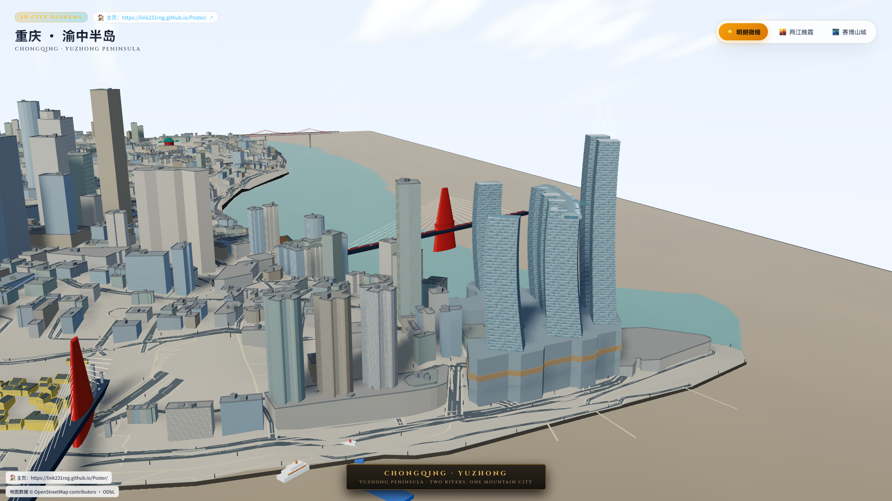

# 重庆 · 渝中半岛 3D 山城沙盘模型 (Project 3D Chongqing)

[English](#english) | [简体中文](#简体中文)

---

<a id="english"></a>
## 🏙️ English

> An interactive 3D miniature diorama of Chongqing's Yuzhong Peninsula (Mother City), built with **Three.js** and **Vite**.

🌐 **Live Demo**: [https://project-3d-chongqin.pages.dev/](https://project-3d-chongqin.pages.dev/)



### Key Features
- **Core Peninsula Diorama**: Accurately highlights iconic landmarks including Chaotianmen, Raffles City (8 towers & The Crystal skybridge), Two Rivers Confluence (clear emerald Jialing vs. sediment-rich Yangtze), Qiansimen Bridge, Dongshuimen Bridge, Zengjiayan Bridge, Yangtze River Cableway, Hongyadong, Liberation Monument, and Shibati.
- **City-Builder Controls**:
  - **Left Drag**: Pan across the terrain.
  - **Right Drag**: Orbit / pitch view smoothly.
  - **Scroll**: Zoom focused on mouse cursor.
  - **Double Click / F**: Smooth focus animation onto clicked building or landmark.
  - **WASD / QE**: Keyboard panning and yaw rotation.
- **Dynamic Lighting Environments**:
  - ☀️ **Daylight**: Crisp natural sunlight with nuanced architectural textures.
  - 🌆 **Sunset**: Warm low-angle golden hour with sky reflections on the water.
  - 🌃 **Cyberpunk**: Chongqing's signature nightscape with volumetric pylon floods on bridges, riverfront light ribbons, and high-rise emissive windows.
- **3D Guided Navigation Routes**:
  - 🪜 **Shibati**: Mountain stairway ticks, platform pacing, and elevation drop profile.
  - 🏢 **Hongyadong**: 11-floor vertical stilt-house complex with multiple ground-level entrances.
  - 🛤️ **Chaotianmen Long Slope**: 1.8 km urban downhill slope and dock stairway profile.
- **Photo Studio**: Built-in portrait booth supporting landmark background captures and local photo synthesis.

### Quick Start

```bash
# 1. Install dependencies
npm install

# 2. Start local development server
npm run dev
```

Open <http://localhost:5173/> in your browser to interact with the 3D scene.

### Test & Build

```bash
# Run unit tests
npm test

# Build for production
npm run build

# Preview production build locally
npm run preview
```

### Project Structure

```text
├── src/
│   ├── main.js                 # Scene init, lighting setups, render pipeline & animation loops
│   ├── peninsula.js            # Peninsula terrain mesh, roads and OSM building lofting
│   ├── navigation.js           # 3D route tubes, HUD statistics, and guided camera controller
│   ├── nav-model.js            # Pure route math, elevation sampling, and stair flight splitting
│   ├── city-lights.js          # Night lighting instancing, bridge pylons & streetlight grids
│   ├── raffles-layout.js       # Mathematical layout and lofting of Raffles City & Skybridge
│   ├── camera-interaction.js   # Pan/drag thresholds and smooth focus pose interpolation
│   ├── quarters.js             # Historical heritage quarters (Huguang Guild Hall, Shibati)
│   └── style.css               # Modern sleek HUD, floating controls & photo booth styling
├── tools/                      # Geographic data extractors & preprocessing scripts
├── docs/                       # Architecture, sources, development guide & handoff logs
└── index.html                  # HTML structure, UI panels & font imports
```

### Data Sources & License
- Geographic footprints and road networks courtesy of [OpenStreetMap](https://www.openstreetmap.org/copyright) contributors (ODbL).
- Elevation data sampled and processed from SRTM satellite elevation sets.
- Code released under the [MIT License](LICENSE).

---

<a id="简体中文"></a>
## 🏙️ 简体中文

> 基于 **Three.js** 与 **Vite** 构建的重庆渝中半岛母城三维交互微缩沙盘模型。

🌐 **在线体验 (Live Demo)**: [https://project-3d-chongqin.pages.dev/](https://project-3d-chongqin.pages.dev/)


### 核心特性
- **母城核心微缩还原**：精细聚焦朝天门、来福士 8 塔与水晶连廊、两江汇流（嘉陵江碧青 vs 长江沙褐）、千厮门大桥、东水门大桥、曾家岩大桥、长江索道、洪崖洞、解放碑、十八梯等标志性建筑群与山地地貌。
- **游戏级交互手势 (City-Builder Controls)**：
  - **左键拖拽**：沿地表平移 (Pan)
  - **右键拖拽**：自由旋转与俯仰 (Orbit / Pitch)
  - **鼠标滚轮**：向光标所在位置平滑缩放 (Zoom to Cursor)
  - **双击 / 快捷键 F**：平滑飞行聚焦目标建筑
  - **WASD / QE**：键盘平移与视角旋转
- **多时相环境光影**：
  - ☀️ **明朗微缩**：白天自然光照与清晰建筑质感
  - 🌆 **两江晚霞**：低角度暖橙夕阳与晚霞水面反射
  - 🌃 **赛博山城**：重庆标志性两江夜景，包含千厮门/东水门金黄立体泛光、沿江光轨与高低楼宇夜间灯光
- **3D 立体导航演示 (Guided Routes)**：
  - 🪜 **十八梯**：步道阶梯、平台节拍与高低落差剖面演示
  - 🏢 **洪崖洞**：11 层立体垂直楼层体系与多首层标高入口切换
  - 🛤️ **朝天门 — 解放碑**：近 1.8 km 穿城长坡与码头大梯道高程剖面
- **山城纪念照相机 (Photo Studio)**：内置合影功能，支持选择不同地标背景镜头并合成人像。

### 本地运行

```bash
# 1. 安装依赖
npm install

# 2. 本地开发调试
npm run dev
```

在浏览器打开 <http://localhost:5173/> 即可实时交互浏览。

### 测试与构建

```bash
# 运行单元测试
npm test

# 生产环境打包
npm run build

# 本地预览构建产物
npm run preview
```

### 目录架构

```text
├── src/
│   ├── main.js                 # 主入口、场景初始化、光照环境与动画管线
│   ├── peninsula.js            # 渝中半岛地形网格生成、普通建筑群与道路系统
│   ├── navigation.js           # 3D 路线、剖面图表与导航演示状态机
│   ├── nav-model.js            # 路线插值、高程采样与统计计算纯函数
│   ├── city-lights.js          # 夜间路灯网格、沿江光带与大桥泛光设施
│   ├── raffles-layout.js       # 来福士八塔、水晶连廊与裙楼空间布局算法
│   ├── camera-interaction.js   # 交互手势与相机姿态判定逻辑
│   ├── quarters.js             # 历史风貌区（湖广会馆、十八梯）模型构建
│   └── style.css               # 交互面板、HUD 导航与 UI 样式
├── tools/                      # 地理数据提取与离线工具
├── docs/                       # 开发交接、架构设计、数据来源与排障文档
└── index.html                  # 页面结构与 UI 面板挂载点
```

### 数据说明与开源协议
- 地理与道路轮廓数据来源于 [OpenStreetMap](https://www.openstreetmap.org/copyright) contributors (ODbL 协议)。
- 地表高程数据基于 SRTM 卫星高程采样处理。
- 本项目遵循 [MIT 许可证](LICENSE) 开源。
